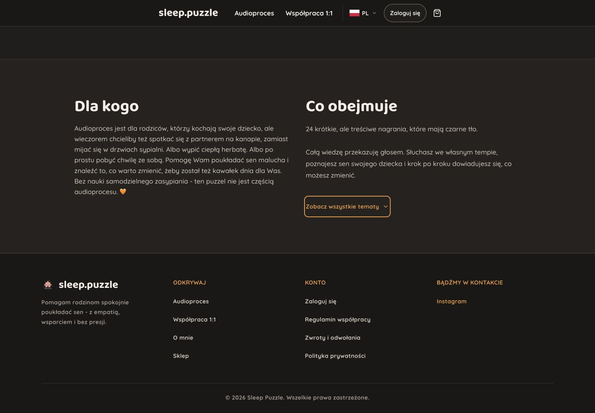
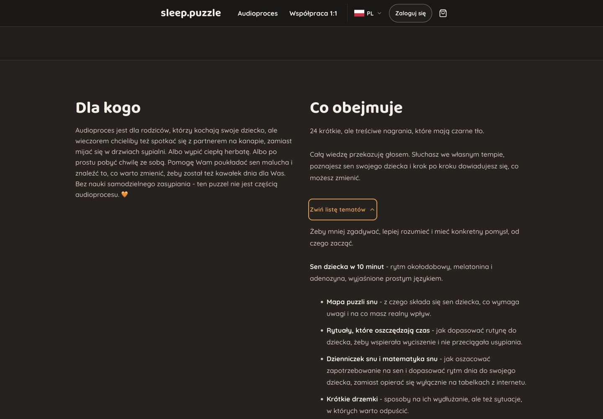

# CMS includes disclosure — 13 October 2026

The initial request named `/packages`; clarification identified the CMS-fed “Co obejmuje” content, which is on `/audioproces` in the current implementation. The target inference was announced before edits. Package cards/dialogs and the “Dla kogo” copy remain unchanged.

## Simplification

The existing warm dark palette, typography and reading-disclosure pattern are preserved. A short introduction stays visible; a native details control reveals the remaining CMS content in place. The current real copy shows 199 characters initially instead of 1,939, retaining all 15 listed topics, bonus content and access information.

Whole leading paragraphs are used, up to two paragraphs and 320 characters in total. No sentences are cut, rewritten, duplicated or removed. Lists, headings, media, long paragraphs and subsequent content stay together in the expanded region. Short copy with no remainder renders directly. List-first or long-paragraph-only entries are entirely available under the disclosure. Development render comments do not prevent introduction extraction. Existing rich-text sanitization remains in place before parsing.

The native summary has a 44px minimum target, amber hover/focus states and an existing chevron that changes direction. Its accessible name includes the section heading; the browser exposes collapsed/expanded state. “Zobacz wszystkie tematy” changes to “Zwiń listę tematów” while expanded, with English equivalents. Both labels are CMS fields with shipped defaults. The existing real H2 and chapter region relationship remain intact. No JavaScript or dependency was added.

## Verification

14 focused examples passed: four rich-content splitting cases, seven audio landing request cases, and three browser cases. Polish and English mobile keyboard expansion/collapse work with JavaScript disabled; focus remains on the summary. Short CMS copy renders without a disclosure. The existing legacy markdown-formatting assertions now inspect the collapsed content explicitly.

Production build, Ruby lint (four files), and whitespace diff checks passed. The shared JavaScript entrypoint remains 295.33 kB minified / 83.03 kB Vite gzip estimate. A disposable test database used the application schema with only the optional pg_stat_statements extension omitted for local permissions, and was removed afterward.

Desktop 1440px and phone 390px collapsed/expanded states were inspected. Neither had horizontal overflow. The rendered control had a solid visible keyboard outline and a 44px target, with an appropriate accessible name and state. No console warnings/errors appeared. Viewport overrides were reset. Verification stayed within the initial inspection and one repair/confirmation pass.

The Impeccable detector found one advisory about the existing 110px hero display size, outside this content-disclosure change. It was preserved with the established visual system. This task changes presentation only: it does not reconcile the previously documented mismatch between the local program declaration and the promise of 24 recordings, nor certify trailer playback or caption support.

Changes remain local and uncommitted.

