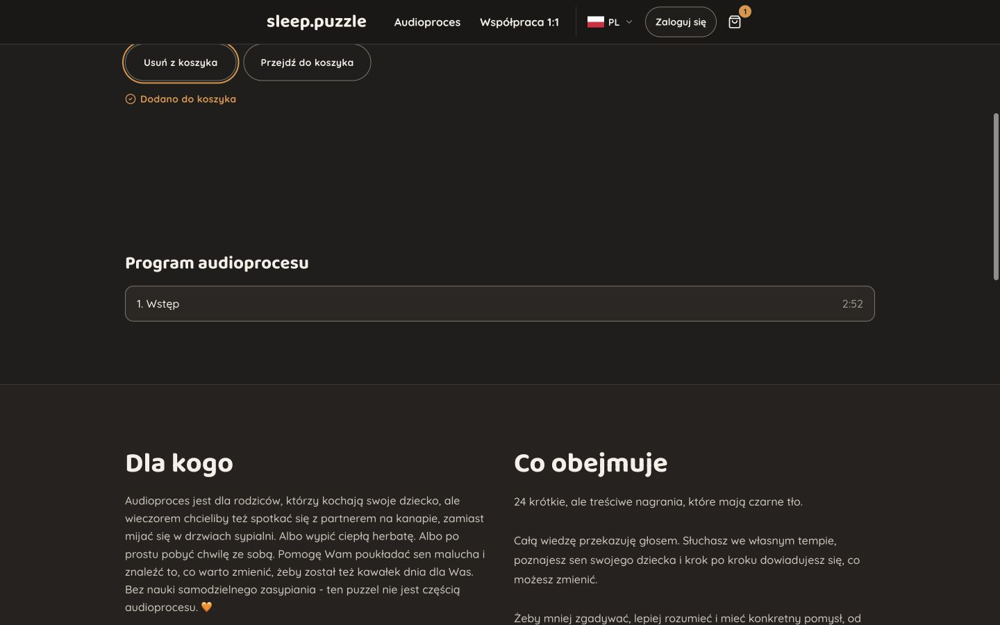
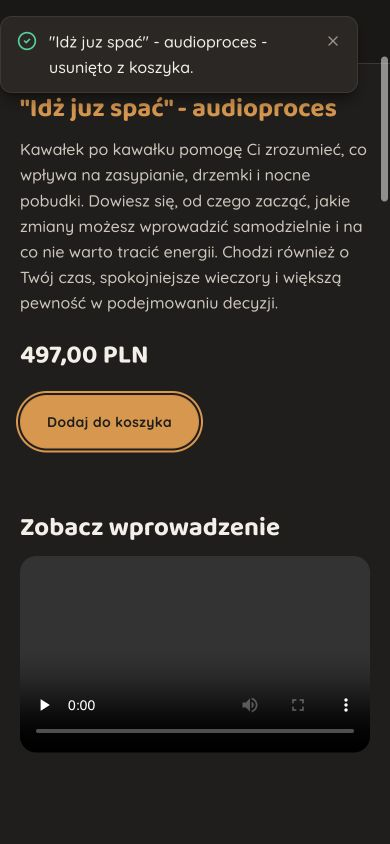

# /audioproces polish — 13 October 2026

Scope: confirm the repaired heading hierarchy and refine interaction details while preserving the established Sleep Puzzle visual system. This is a bounded refinement, not a release-readiness certification or full re-audit.

## Confirmed hierarchy

The live page has one main H1, “Audioproces”. The product title, trailer, program, audience, and included-content sections are real H2s. “Program audioprocesu” has the stable ID `chapter_outline_heading_product_2`; its section references that ID through `aria-labelledby`. The accessible region name contains the heading text, with no leaked markup. Ordered chapters remain readable list content rather than pretend playback controls.

Parsed request coverage confirms the chapter-heading relationship in Polish and English, with legacy, incomplete, purchased, and empty states retained. Runtime checks confirm the same hierarchy at 320, 390, 768, and 1440px.

## Interaction repair

The initial keyboard check reproduced the audit's focus loss: submitting Add or Remove replaced its control cluster and left focus on BODY. A shared `cart-focus` Stimulus controller now restores focus to the corresponding replacement submit button when submission starts from a visibly focused keyboard control.

Pointer activation retains its existing behavior. Pointer input, Tab, or focus movement while a response is pending cancels restoration. This prevents a slow response from pulling a visitor back after they have moved elsewhere. The controller applies to both full product actions and shop-card toggles, the two regions replaced by the existing cart streams.

The existing busy/disabled submit feedback, localized button names, polite success confirmation, cart navigation, native forms, and availability guards remain intact. Live checks confirmed:

- Enter adds the program and focuses Remove, with the existing amber outline.
- Tab continues to “Przejdź do koszyka”.
- Removal returns focus to Add and removes the cart link.
- The focused control keeps its 2px amber outline with a 2px offset and a 53.6px height.
- Mobile Menu opens by keyboard, moves focus to its first link, and Escape returns focus to Menu.

## Visual preservation

No palette, typeface, typography classes, layout, spacing, imagery, public copy, or motion was changed. The production CSS asset hashes remain `application-DspE3GBa.css` and `application-Bh2jpL6a.css`, identical to the preceding optimization pass. The existing heading sizes, chapter rows, native trailer, and section rhythm are retained.

Desktop and phone captures were inspected in the initial round, followed by one confirmation round. No horizontal overflow was observed at 320, 390, 768, or 1440px. The original contrast evidence remains applicable to the unchanged tokens; the restored focus outline was inspected in the rendered page. No browser errors or warnings were observed during the checked interactions.

## Verification

**16 examples passed:** 5 new interaction system cases, 4 deferred-feature system cases, and 7 audio landing request cases. New coverage includes exact 1440px and 390px emulated viewports, Enter/Space toggling with retained visible focus, pointer activation, Tab during a deliberately delayed response, and the shared shop toggle.

Production build, Ruby lint for the new system spec, and `git diff --check` passed. Impeccable's detector reported no findings in the changed frontend files. The shared entrypoint is 295.33 kB minified / 83.03 kB Vite gzip estimate; deferred editor/calendar modules remain separate. The existing Vite HMR deprecation and optional local Vips-module warning are unchanged.

Tests used a disposable local database with the application schema, omitting only the optional `pg_stat_statements` extension because the local role cannot install it. That database was removed after verification. Browser cart additions were undone; the tested session ended with the original empty cart. Viewport overrides were reset.

## Unresolved content and release limits

A read-only query confirms that the selected local product currently declares **1 expected chapter**, has **1 uploaded ready chapter**, and is therefore purchase-ready according to its configuration. Its editable offer still promises **24 recordings**. The completeness guard enforces the declared count correctly, but cannot verify whether that declaration matches the marketed offer. The owner must reconcile the count, delivered program, and copy before this data is released. No factual copy or product data was silently changed in this polish pass.

The original audit's trailer recovery/caption verification and price-outage access findings remain outside this narrow pass. The trailer's visual presence and native controls are not proof of successful playback or caption conformance.

Changes remain local and uncommitted.

